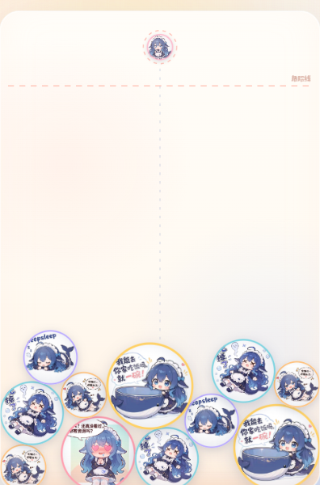

# 合成女仆酱

一个致敬《合成大西瓜 / 合成大奶娃》的浏览器小游戏：把蓝毛小女仆表情包丢进罐子里，相同的撞在一起就会合成更大的一只，越合越大，直到「暴走鲸」把罐子塞满。



## 玩法

- **鼠标**：移动瞄准，点击投放
- **触屏**：按住拖动瞄准，松手投放
- **键盘**：`←` `→` 微调位置，`空格` 投放，`R` 重开
- 两只相同的女仆相撞会合成下一级，并获得分数
- 堆过顶部虚线并停住约 1.6 秒，本局结束
- 每 **2000 分** 攒一枚 **女仆币**
- 两只最高级 **暴走鲸** 撞在一起会一起炸掉，换 **999 分 + 一枚女仆币**
- 游戏结束时如果手里还有女仆币，可以选择复活，清掉顶部的危险球继续玩

## 11 级合成链

| 等级 | 名字 | 等级 | 名字 |
| --- | --- | --- | --- |
| 1 | 小女仆 | 7 | 求资源 |
| 2 | 打招呼 | 8 | 干饭鲸 |
| 3 | 懵圈鲸 | 9 | 破防鲸 |
| 4 | 吃饱饱 | 10 | 崩溃鲸 |
| 5 | 摸鱼觉 | 11 | 暴走鲸 |
| 6 | 摆烂鲸 | | |

## 功能

- Matter.js 物理模拟，圆形碰撞、堆叠、合成
- Canvas 2D 渲染，支持高清屏与窗口缩放
- 合成粒子、冲击波、飘分、屏幕震动、合成音效（WebAudio 实时合成，无需音频文件）
- 分数 / 最高分 / 女仆币 / 下一个预览 / 合成表
- 本机排行榜、昵称修改，数据保存在 `localStorage`
- 键盘、鼠标、触屏均可游玩，响应式布局

## 运行

直接双击打开 `index.html` 即可。

如果浏览器限制本地文件，也可以在本目录起一个静态服务器：

```bash
python -m http.server 8765
```

然后访问 <http://127.0.0.1:8765/>。

## 素材

游戏里的 11 张女仆表情包、圆角贴纸风格与标题字体来自 DSH 桌面宠物（`dsh-pet`）自带的素材库：

- `assets/balls/01.png` ~ `11.png`：`dsh-pet/assets/memes` 中的 11 张表情包
- `assets/fonts/cute.ttf`：`dsh-pet/assets/fonts/上首软糖体.ttf`
- 物理引擎：`matter-js` 0.20.0（已本地化到 `js/matter.min.js`）

## 目录

```text
index.html
css/style.css
js/game.js
js/matter.min.js
assets/balls/01.png ... 11.png
assets/fonts/cute.ttf
```
